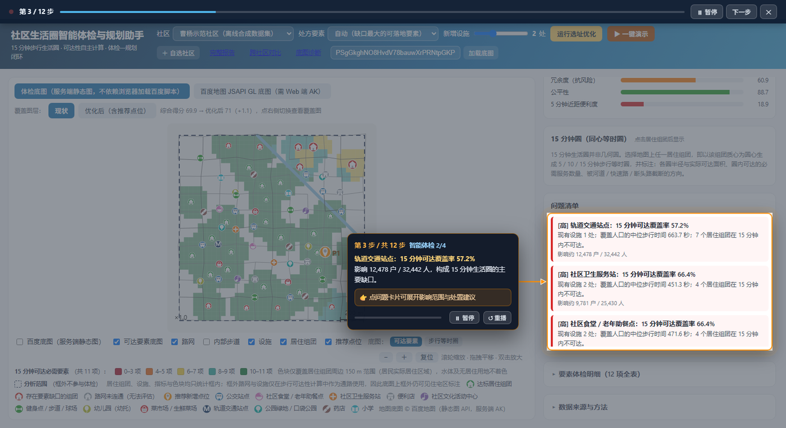
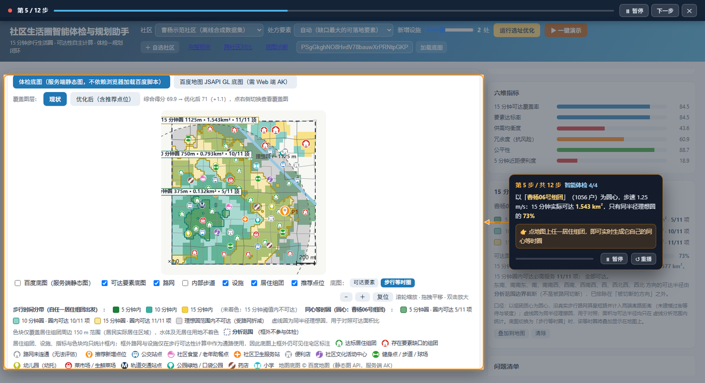
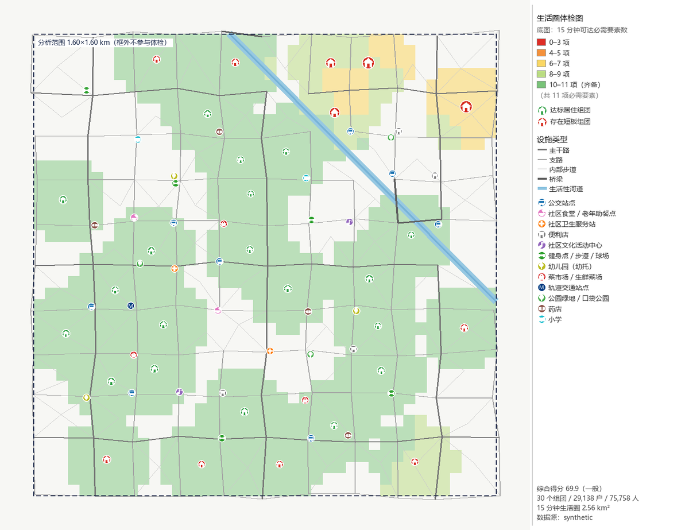

# 社区生活圈智能体检与规划助手

> 2026 上海开源软件应用创新大赛 ·【开源 AI 工具赛道】百度地图赛题
> 定位：社区生活圈体检引擎与设施选址建议器，覆盖「诊断 → 处方」全链路。

状态：可用。引擎、指标、报告与交互式演示均已完成，`.\tasks.ps1 verify` 全绿
（规范与内链检查、49 项单元测试、48 项 API 自检、12 步演示自检、19 项打包自检）。

文档导航：[指标口径](docs/metrics.md) · [数据契约与数据源切换](docs/data-schema.md) ·
[选址模型](docs/siting.md) · [百度 AK 接入](docs/baidu-ak.md) ·
[脚本索引](tools/README.md) · [立项方案（历史文档）](docs/plan.md)

---

## 1. 快速开始

仓库**不含真实数据集**（百度 POI 的派生数据受开放平台条款限制，不再分发）。开箱可跑的是
**离线合成社区** `caoyang-demo`：由代码确定性生成，不需要 AK，也不需要外网。

```bash
pip install -r requirements.txt            # fastapi / uvicorn / requests / pillow / shapely
python tools/build_demo.py caoyang-demo    # 生成合成数据集与体检报告（约 10 秒，全程离线）
python tools/serve.py --warm --open        # 打开 http://127.0.0.1:8000
```

查看**真实街道**（曹杨新村等 5 个社区）的结果，有两种方式：

| 方式 | 操作 |
| --- | --- |
| 自行生成数据（推荐，约 10 分钟） | ① `cp .env.local.example .env.local`，填入 `BAIDU_SERVER_AK`（[申请指引](docs/baidu-ak.md)）② `python tools/add_community.py --name "曹杨新村街道" --address "上海市普陀区曹杨新村街道办事处" --half-width 800` ③ `python tools/build_demo.py <社区id>` |
| 复算已验证结论 | 本文引用的数字均出自 `out/<社区>/diagnose.json` 等结构化结果，可按上述命令用同一套脚本复算 |

界面中数据未生成的社区显示为「未生成数据」，选中时给出上述操作提示，不会静默失败。

```powershell
.\tasks.ps1 verify   # 一条命令跑完全部自检：规范 / 内链与密钥 / 单测 / API / 演示 / 打包
```

---

## 2. 界面预览

截图取自离线合成社区 `caoyang-demo`，并关闭百度底图图层：路网、色块与图标均为本项目自绘，
不含第三方地图影像。

| 一键演示（聚光导览） | 单组团同心等时圈 |
| --- | --- |
|  |  |

一键演示每一步压暗无关区域，用橙色框标出当前讲解的控件，并由指向卡引折线箭头指向目标；
需要观众操作的步骤附加交互提示。顶部控制条只保留步数与暂停 / 跳转。



报告中的体检底图由 PIL 自绘、不依赖网络：色块表示 15 分钟内可达的必需要素数量，
虚线框为**分析范围**（框外居住区不参与体检），右侧为图例与口径说明。

---

## 3. 运行与自检

Windows 下可直接双击：

| 双击 | 作用 |
| --- | --- |
| `启动演示.cmd` | 检查依赖 → 释放端口 → 启动服务 → 就绪后自动打开浏览器（关闭窗口即停止）。换端口：`启动演示.cmd 8080` |
| `跑检查.cmd` | 全部离线自检：规范检查 + 49 项单元测试 + 48 项 API 自检 + 12 步演示自检 + 19 项打包自检 |

命令行等价目标：

```powershell
.\tasks.ps1 dev      # 启动服务并自动打开浏览器（日常使用）
.\tasks.ps1 verify   # 全部离线自检（自检使用 8123 端口，不影响正在运行的 8000）
.\tasks.ps1 demo     # 生成数据 → 可达性 → 体检 → 选址优化 → 报告
.\tasks.ps1 demoall  # 刷新全部社区报告、风圈图与跨社区对比页
.\tasks.ps1 test     # 只跑单元测试
.\tasks.ps1 help     # 全部目标
```

Linux / macOS 或已安装 make 时可用 `make demo` / `make serve` / `make test`。

脚本编码约定（修改时需遵守）：`tasks.ps1` 必须保存为 **UTF-8 带 BOM**，否则 Windows
PowerShell 5.1 按 GBK 解析中文注释并报 `Unexpected token '{'`；`.cmd` 必须为**纯 ASCII**，
因为 cmd.exe 按控制台 ANSI 码页读取批处理文件。两个 `.cmd` 仅转调 `tasks.ps1`。

---

## 4. 真实数据结果

### 4.1 曹杨新村街道（试点社区，1.6 km × 1.6 km）

数据源：百度地图开放平台地点检索（POI，BD-09 已换算为 WGS-84）+ OpenStreetMap（步行路网、
建筑轮廓）；人口按七普街道密度做总量校准（口径见 4.3）。

| 指标 | 结果 |
| --- | --- |
| 综合体检得分 | **82.8（良好）** |
| 规模（分析范围内） | 98 个居住组团 / 45,209 户 / **117,543 人** / 109 处设施 / 7,417 个路网节点 |
| 15 分钟生活圈面积 | 2.56 km² |
| 最短板要素 | 社区文化活动中心可达覆盖率 **49.4%**（22,874 户、59,472 人不可达）；社区卫生服务站 77.1% |
| 处方：社区文化活动中心 +2 处 | 覆盖率 **49.4% → 99.2%**，优化后综合得分 85.8 |
| 自算路网 vs 百度步行路径规划（30 组抽样） | 距离比中位数 **1.033**、时间比中位数 0.909、**15 分钟判定一致率 96.7%**；百度隐含步速 1.13 m/s（本项目 1.25 m/s）；时间比 >2 的离群样本 3 组 |
| 单组团同心等时圈（梅花园 CR029 实测） | 实际可达 1.134 km² ÷ 同半径理想圆 1.89 km² = **可达面积比 60.0%**，受河道、快速路与封闭小区折减 0.757 km² |

得分高于早期版本（72.8），原因是修正了五个数据口径缺陷，五项均记录在
[docs/metrics.md §4](docs/metrics.md)：

| # | 口径缺陷 | 修正 |
| --- | --- | --- |
| ① | OSM `oneway` 约束的是**机动车**，早期按行人单行处理，造出 278 条人工断头路 | 只认 `oneway:foot` |
| ② | 商家名称被关键词匹配成地铁站、公园（如「XX酒店(…地铁站店)」「申亚时代广场」） | metro / bus_stop / park 需 `tag`/`type` 二次确认 |
| ③ | 小区内部路在离主路数十米处中断，整片组团被误判为「无任何设施」 | 跨连通块补连（≤60 m，跨水不连），接不上的标注「无法评估」 |
| ④ | 路网抓取范围等于分析方框，而 15 分钟步行（1125 m）长于半边长（800 m），贴边组团被硬切 | 抓取范围外扩 1200 m，分析范围不变 |
| ⑤ | 百度地点检索为圆形（半径 1040 m），框外住宅区 POI 被当作分析单元，覆盖率被系统性拉低 | OSM 与百度补充走同一道分析范围判定，并在地图上画出分析范围框 |

### 4.2 其他社区

| 社区 | 分析范围 | 规模 | 综合得分 |
| --- | --- | --- | --- |
| 长风新村街道（真实数据） | 1.8 km × 1.8 km | 152 个居住组团 / 25,982 户 / 67,553 人 / 113 处设施 | 73.9（良好） |
| 北新泾街道 | 1.6 km × 1.6 km | 55 个居住组团 / 5,966 户 / 85 处设施 | 81.4（良好） |
| 大场镇 | 1.6 km × 1.6 km | 77 个居住组团 / 9,433 户 / 55 处设施 | 70.1（良好） |
| 程家桥街道 | 1.6 km × 1.6 km | 56 个居住组团 / 3,510 户 / 35 处设施 | 64.7（一般） |

六个社区在同一套要素清单与引擎下横向对比，结果见 `out/compare.html`。其中大场镇是口径缺陷 ③
的发现地，程家桥是缺陷 ⑤ 的发现地。

### 4.3 户数口径（三级可信度，自动择优）

| 级别 | 来源 | 使用方式 |
| --- | --- | --- |
| ① 实测 | 街道 / 居委实测户数 | 放 `data/households/<社区id>.csv`（`name,households[,lon,lat]`），自动优先并跳过校准 |
| ② 普查总量校准 | 七普常住人口 ÷ 街道面积 → 人口密度 × 分析范围面积 | 社区配置 `population_calibration`（本项目两个真实社区已配置） |
| ③ 空间结构 | OSM 建筑轮廓 × 层数 ÷ 91 m² | 默认值；②③ 只调整总量，不改变空间分布 |

曹杨新村：七普常住人口 98,267 人 ÷ 街道面积 2.14 km² = 45,919 人/km² × 分析范围 2.56 km²
= 目标 117,553 人；OSM 原始估算为 39,949 人（偏低 2.94 倍），校准后 117,543 人。
校准前综合得分 86.1 → 校准后 82.8：人口被低估时「供需均衡度」会误判为设施充足。

### 4.4 自选社区（任意地址直接出体检结论）

三种入口共用同一套装配逻辑：

```powershell
# 1) 命令行
python tools\add_community.py --name "长风新村街道" `
  --address "上海市普陀区中山北路3671弄长风新村街道办事处" `
  --half-width 900 --population 120920 --area 5.8
python tools\build_demo.py custom-078ed4        # 生成报告

# 2) 网页：右上角「＋ 自选社区」→ 填写名称 / 地址 / 范围（可选常住人口与面积）→ 开始分析（20–60 秒）
#    也可用 http://127.0.0.1:8000/?new=1 直接展开面板

# 3) API
POST /api/communities   {name, address|lon/lat, half_width, population?, area_km2?}
DELETE /api/communities/{id}
```

流程：地址 → 百度地理编码（BD-09 → WGS-84，返回置信度，偏低时警告）→ 百度地点检索获取 POI、
Overpass 获取步行路网与建筑 → 户数校准 → 加入社区列表并渲染。原始响应全部缓存，重复运行不再
消耗配额。自选社区需要外网；无外网时离线合成社区仍可完整演示。

### 4.5 离线合成数据

30 个居住组团 / 29,138 户 / 75,758 人，综合 **69.9（一般）**。生成器只构造河道与设施分布：
河道打断 12 处过河通道、只保留 3 座桥，跨河片区 7 个组团 15 分钟内无地铁；处方
「社区卫生服务站 +1 处」使覆盖率 66.4% → 100%。缺陷由数据本身涌现，引擎不含针对该数据集的判定。

---

## 5. 交付物

| 交付物 | 位置 | 说明 |
| --- | --- | --- |
| 交互式演示 | `web/` + `tools/serve.py` | 一键演示（快速版约 2.5 分钟 / 完整版约 4 分钟，12 步自动播放：体检 → 等时圈 → 规划 → 处方 → 住户的一天 → 百度地图）；体检 / 规划双模式；社区切换与自选社区；图层开关；底图口径切换（可达要素数量 / 步行等时圈）；点居住组团出同心等时圈；5 类典型住户的一天；滚轮缩放、拖拽平移与复位；悬浮查询；一键重跑选址优化；点位画像；动线播放与 PNG 导出；两种底图；地图与图例共用一套语义图标 |
| 跨社区对比 | `out/compare.html` | 六个社区同一口径横向对比（得分、六维、最短板、处方、稳健区间、路网质量） |
| 自选社区 | `/api/communities` + `tools/add_community.py` | 输入地址即拉取真实数据并出体检结论（20–60 秒），支持可选人口总量校准 |
| 户数校准 | `lifecycle_metrics/pipeline.py` | 实测 CSV > 普查总量校准 > OSM 估算，三级自动择优且幂等（不会复利缩放） |
| 住户画像 | `config/personas.json` + `lifecycle_metrics/route.py` | 5 类典型住户（活力老人 / 双职工 / 带娃家庭 / 中小学生 / 行动不便者）：出行链、停留时长、设施开放时段、步速、可接受单段步行时间。规则表可核对、可复现、离线可用，不接入大模型现场判定 |
| 同心等时圈 | `lifecycle_metrics/isochrone.py` + `/api/isochrone*` | 以组团为圆心：5 / 10 / 15 分钟分带、等时线、理想圆虚线、可达面积比、16 方向可达半径（识别被河道 / 快速路切断的方向）、每圈可达要素数 |
| 底图诊断页 | `web/diag.html`（`/diag.html`） | 在出现问题的浏览器中逐项探测网络、脚本、BMapGL 与 AK，定位失败环节 |
| JSAPI GL 底图 | `web/app.js` + `/api/overlay.*` | 与体检底图同一口径：服务端渲染透明色块 PNG 贴到 GL 地图；风圈叠加图与圈上刻度用 GL 标签；组团按达标 / 短板 / 无法评估三色；点位编号绘制进图标；一天动线绘制在 GL 上（折线 + 序号停靠点 + 离路虚线 + 播放圆点，自动调整视野）；设施默认关闭且放大到 16 级才显示；分析范围外不绘制 |
| 体检报告 | `out/<社区>/report.html` / `report.md` | 结论速览、六维雷达、步行等时圈图与单组团同心等时圈、要素体检表与标准依据表、问题清单、空间分布、一个居民的一天（动线 + 时刻表）、同一组团五类住户对比、处方、点位画像、边际效益曲线、误差分析与坐标对齐核验、结论稳健性、数据质量与路网连通性、口径声明 |
| 结构化结果 | `out/<社区>/diagnose.json` / `optimize.json` / `walk_calibration.json` | 报告中每个数字的机器可读来源 |
| 体检地图 | `out/<社区>/map_*.png` | 自包含底图，不需要网络；设施与组团使用与前端同一套语义图标 |
| 对齐核验 | `tools/align_check.py` · `tools/basemap_align_probe.py` | 前者将自建路网叠加到百度底图供目视核验；后者实测静态图 API 的分辨率与残余平移，两项均在容差内才判定对齐 |
| 可复用引擎 | `lifecycle_metrics/`（可 `pip install -e .`） | 可达性、指标、选址优化与坐标换算，不依赖在线服务 |
| 口径与数据契约 | `docs/metrics.md`、`docs/data-schema.md` | 指标定义、权重、出处与局限；坐标系约定与数据源切换 |
| AK 接入说明 | `docs/baidu-ak.md` | 所需 AK 类型、开通服务、联调已知问题与合规要求 |
| 分辨率探针页 | `web/scale_probe.html`（`/scale_probe.html`） | 用 JSAPI `pointToPixel` 反推 zoom 16 下的真实 m/像素，校验底图缩放口径 |
| 脚本索引 | `tools/README.md` | 34 个脚本按「主链路 / 自检与验收 / 出图与对比 / 一次性探针」分类 |
| 立项方案 | `docs/plan.md` | 立项期的方案与验收标准（历史文档，含计划与实现的差异对照） |

---

## 6. 技术要点

1. **可达性自算**：OSM / 合成路网 + Dijkstra（标准库 heapq 实现），设施与组团吸附到最近路网节点，
   并将「离路距离 ÷ 步行速度」计入惩罚时间。厂商配额受限或接口变更不影响项目运行，算法可解释、可复核。
2. **生活圈范围 = 所有居住组团 15 分钟可达区域的并集**，不是以社区中心为圆心的缓冲区。
3. **体检图以「可达必需要素数量」着色**，而非最短时间：时间并集在大范围内均可达，要素数量才能
   直接显示服务洼地。
4. **双向口径**：同时测「该有的有没有」（覆盖率、达标率）、「是否只依赖一处」（单一依赖率）、
   「组团之间是否公平」（加权 Gini）与「5 分钟近距便利度」。
5. **处方可落地**：选址优化只对 `sitable=true` 的要素开处方（不会建议新建地铁站），
   采用贪心最大覆盖 + 1-opt 局部搜索，输出推荐点位、新增覆盖户数与前后对比。
6. **数据源可插拔**：`synthetic` / `osm` / `baidu` 三种 provider 产出同一份 `Dataset`，
   引擎、指标、报告与前端无需改动。
7. **规划建议因人而异、因时而异**：同一组团更换住户画像即更换出行链、步速与开放时段约束。
   画像为规则表，可核对、可复现、离线可用；大模型仅用于两端（解析自然语言、转述结论），
   不进入中间环节，避免不可复现与离线失效。
8. **15 分钟圈绘制为真实路网上的等时圈**，不是几何同心圆：同一时间阈值下，隔着河道或快速路的
   实际可达范围差别显著，几何圆会掩盖真实路网这一技术差异点。可视化沿用风圈的视觉语言
   （分层色带、等时线、圈上刻度、可达面积比、被切断方向）。
9. **步速计入生活圈**：同一条路，成人 15 分钟步行 1125 m、老人 765 m、助行器 540 m。
   「是否达标」需与出行主体一并说明，同一组团可同时出现「成人口径达标」与「助行器口径均不可达」。
10. **动词与数字均可追溯**：tier1 / tier4 表述为「邻近」，tier2 / tier3 为「可合署」；
    每个数字附口径（「15 分钟可达覆盖率 49.4%」，而非「49.4% 人口可在 15 分钟内到达」）。
    对外文案口径见 [docs/metrics.md §16](docs/metrics.md)。

---

## 7. 六维指标与权重

| 维度 | 权重 | 含义 |
| --- | --- | --- |
| 15 分钟可达覆盖率 | 0.28 | 必需要素的人口加权覆盖比例 |
| 要素达标率 | 0.26 | 11 项必需要素全部可达的人口占比 |
| 供需均衡度 | 0.18 | 设施服务能力与覆盖人口的匹配程度（1 − 缺口指数） |
| 冗余度（抗风险） | 0.10 | 同一要素有 ≥2 处可达的人口占比 |
| 公平性 | 0.10 | 组团达标得分的加权 Gini 补值 |
| 5 分钟近距便利度 | 0.08 | 便利度梯度（原「绿色可达性」因只建模步行而替换） |

定义、计算式、出处与已知局限见 [docs/metrics.md](docs/metrics.md)。

---

## 8. 架构

```
config/elements.json      口径唯一来源（要素清单 / 必需性 / 可选址 / 服务人口 / 权重）
        │
providers/  synthetic │ osm │ baidu  ──►  Dataset（统一契约）
        │
graph.py        路网图 + 带截断 Dijkstra（纯标准库）
accessibility.py 吸附惩罚 · 设施可达矩阵 · 生活圈栅格 · 可达要素数量栅格
metrics.py      六维指标 + 综合得分 + 问题清单
optimize.py     贪心最大覆盖 + 1-opt（处方）
raster.py       自包含体检图（PIL，不依赖地图瓦片）
report.py       Markdown / HTML 报告（含雷达图与前后对比）
        │
tools/serve.py  FastAPI：/api/bundle /api/diagnose /api/optimize /api/report + 静态前端
web/            canvas 渲染（离线可用）+ 可选百度地图 JSAPI GL 底图
```

---

## 9. 百度地图 AK 接入

两个 AK 配置在 `.env.local`（已 gitignore，不进入仓库）：

```
BAIDU_WEB_AK      浏览器端（JSAPI GL）→ 由 /api/config 下发给前端，交互式底图已验证
BAIDU_SERVER_AK   服务端 → 地点检索 / 地理编码 / 步行路径规划（未开 SN 校验，无需 SK）
```

联调结论与已知问题（BD-09 与 WGS-84 相差约 1.16 km、`tag`/`type` 位于 `detail_info` 内、
地铁出入口需合并、POI 覆盖不全需多源并集、两类 AK 不可混用、静态图不可带 `scale`、
浏览器 JSAPI 可能被本地网络拦截）见 [docs/baidu-ak.md](docs/baidu-ak.md)。校验脚本：

```powershell
python tools\check_baidu_ak.py      # 三类接口的 status 与耗时
python tools\ak_probe.py --live     # 连通性与 AK 分步探针
python tools\basemap_diag.py        # JSAPI 与静态图可用性
python tools\basemap_scale_check.py # 标定百度 zoom 的实际分辨率（需服务运行）
python tools\crs_check.py           # BD-09 与 WGS-84 偏移量核验
python tools\align_check.py         # 路网叠加到百度底图，目视核验对齐
python tools\basemap_align_probe.py # 对齐定量核验：静态图 API 的 mpp 与残余平移
python tools\overpass_probe.py      # OSM 镜像可用性
```

浏览器端 JSAPI 加载失败时，打开 `/diag.html`（主界面右上角「底图诊断」）逐项探测并给出结论；
无论结果如何，主界面的「体检底图」模式使用服务端静态底图，不依赖浏览器加载百度脚本，
演示始终有可用地图。

---

## 10. 目录结构

```
lifecycle_metrics/     引擎（可独立 pip 安装复用）
  providers/           synthetic.py / osm.py / baidu.py
  route.py             一天动线（住户画像 + 开放时段 + 步速换算）
  isochrone.py         单组团同心等时圈（分带 / 可达面积比 / 方向可达）
config/                elements.json（口径）· personas.json（5 类典型住户）· communities.json（试点社区）
web/                   index.html · app.js · style.css · diag.html（底图诊断）· scale_probe.html（分辨率探针）
tools/                 34 个脚本，索引见 tools/README.md
tests/test_engine.py   49 项回归测试（口径改动必须同步更新）
docs/                  metrics.md · data-schema.md · baidu-ak.md · siting.md · plan.md
data/                  数据集与缓存（不进仓库，见 .gitignore；真实数据需自备 AK 生成）
out/<社区>/            报告、地图、诊断 JSON（不进仓库，可随时重新生成）
```

---

## 11. 打包分发

```powershell
python tools/make_package.py       # 产出 dist/15min-life-circle-demo-<日期>.zip
python tools/verify_package.py     # 解压到临时目录、换端口起服务，逐项自检
```

包的设计要点：

- **不含任何密钥**：排除 `.env.local`，附 `.env.local.example` 模板；
- **离线可用**：打包 6 个社区的数据集、原始响应与出图缓存、已缓存的百度静态底图 PNG，
  收件人在无网络、无 AK 的环境下仍可查看真实地图与完整体检结论（已实测验证）；
- 根目录提供 `请先读我.html`（渲染好的快速上手）、`启动演示.cmd`（一键起服务并打开浏览器）、
  `start-demo.sh` 与完整源码 / 文档 / 测试；
- `verify_package.py` 逐项自检：密钥排除、统一根目录、解压后单元测试、服务可启动、离线数据集、
  无 AK 出底图、底图几何参考、报告可访问、各社区报告齐全、住户画像与同心等时圈离线可用等。

---

## 12. 选址模型（可建性约束）

早期版本只优化可达性，会把设施推荐到河道、机关院内或校园内。现行模型要求
**候选点位于载体梯队周边（1–4 梯队）+ 排除不宜区 + 同类间距达标**，再按
「新增覆盖户数 × 梯队系数」排序。完整口径、数据来源与局限见 [docs/siting.md](docs/siting.md)。

曹杨新村街道实测：载体 95 处（第一梯队 5 / 第二梯队 28 / 第三梯队 45 / 第四梯队 17），
不宜区 40 处，水体与河道要素 42 处；候选点 984 个，筛除水体内 90 个、不宜区内 113 个、
同类过近 80 个。推荐点位 P1 = 中宁路地铁站（3 个出入口）126 m 处（第一梯队 ×1.5，
新增覆盖 19,033 户），P2 = 枫桥路地铁站（3 个出入口）144 m 处（第一梯队 ×1.5，
新增覆盖 8,838 户）。

第五梯队（公交枢纽、地下通道、过街连廊、闲置亭棚）已放弃：百度 POI 取不到此类点位，
曹杨新村街道实测公交枢纽 / 长途汽车站 / 报刊亭 0 处；梯队编号保留 1–4 以对应赛题方原始口径。

---

## 13. 交互功能

1. **模糊搜索街道**：`/api/geocode/search` 走地点检索而非地理编码，因此「曹杨新村街道」
   「长风新村」「打浦桥街道」这类不完整输入均可返回候选列表，每项含名称、地址、行政区与
   WGS-84 坐标，点选即作为分析中心，不要求输入精确门牌地址。
2. **优化后覆盖图**：运行选址优化后，系统将推荐点位作为新设施代入模型重新体检，界面提供
   「现状 / 优化后」切换，覆盖色带与组团达标配色同步切换，面板给出综合得分与六维指标的前后对比，
   报告同时生成 `map_after.png`。曹杨新村实例：综合得分 82.8 → 85.8，社区文化活动中心覆盖率
   49.4% → 99.2%（不可达户数 22,874 → 386）。
3. **点位画像**：每个推荐点位生成「建设形态、规模、受益范围、可合署对象」说明 —— 受益组团数与
   服务人口、到该点步行时间的中位与最长值、可合署的既有设施、容量核对（按工程假设值）、
   审批要点与载体约束。数据由已有结果计算，建设形态 / 规模 / 审批取自 `config/elements.json`
   的 `build_notes`，属工程建议，非标准强制条款。
4. **一天动线**：点击地图上任一居住组团，沿步行路网排布「该组团把必需要素各走一遍」的动线，
   含逐段到访时刻、步行分钟与米数、各处停留时长（可调）、回家段，以及本趟不可达的要素；
   支持「现状 / 优化后」两个场景与「生活动线序 / 就近串点序」两种排序对比。
   曹杨新村实例（报告图 3 的示例组团星港景苑2期）：现状 10 处停靠、步行 60.5 分钟，1 项不可达
   （社区文化活动中心 19.5 分钟）；就近串点序为 44.4 分钟，比生活动线序少 16.1 分钟。
   口径与假设见 [docs/metrics.md §7](docs/metrics.md)：**15 分钟生活圈不等于一天只走 15 分钟**。

> 说明：新增设施后「冗余度（抗风险）」可能略降 —— 刚被覆盖的组团往往只依赖这一处新设施，
> 属正常过渡效应，继续增补第二处即可回升。

---

## 14. 验证与稳健性

以下检验均为本地计算，不联网、不消耗地图配额。

1. **标准依据表**：每个要素在 `config/elements.json::standard_ref` 中挂载配置层级、标准名称、
   应配置 / 宜配置、步行距离口径、建筑面积、`source_url` 与 `verified`。本项目的
   15 分钟 = 1000 m、5 分钟 = 300 m 与 GB 50180-2018 表 3.0.4 的步行距离分级一致；
   出处来自公开检索，12 条全部标注「待核对原文」，核对后将 `verified` 改为 `true`，报告自动更新。
2. **结论稳健性**（`tools/robustness.py`）：将步速（1.10 / 1.25 / 1.35 m/s）与阈值
   （810 / 900 / 990 s）组合为 7 个情景重算：

   | 社区 | 得分区间 | 跨度 | 等级 | 最短板要素 |
   | --- | --- | --- | --- | --- |
   | 曹杨新村 | 79.3–85.3 | 6.0 | 良好↔优良 | 社区文化活动中心（各情景一致） |
   | 长风新村 | 69.7–77.4 | 7.7 | 良好↔一般 | 社区文化活动中心 |
   | 北新泾 | 78.8–83.2 | 4.4 | 稳定（良好） | 社区文化活动中心 |
   | 程家桥 | 58.2–68.5 | 10.3 | 稳定（一般） | 社区食堂 / 老年助餐点 |
   | 大场镇 | 64.6–74.8 | 10.2 | 一般↔良好 | 社区文化活动中心 |
   | 合成数据集 | 65.7–75.3 | 9.6 | 一般↔良好 | 轨道交通站点 |

   总分区间跨度为 4–10 分，引用时应给出区间；最短板要素在所有情景下不变，补设施的方向稳定。
3. **边际效益曲线**（`tools/marginal.py`）：k = 1/2/3/4 各运行一次选址优化，回答「为什么是 2 处」。
   曹杨新村（社区文化活动中心）：

   | 建 k 处 | 覆盖率 | 累计新增覆盖 | 第 k 处边际增量 | 平均每处 |
   | --- | --- | --- | --- | --- |
   | k=1 | 91.5% | 19,033 户 | **+19,033** | 19,033 |
   | k=2 | 99.2% | 22,488 户 | +3,455 | 11,244 |
   | k=3 | 100.0% | 22,874 户 | +386 | 7,625 |
   | k=4 | 100.0% | 22,874 户 | **+0** | 5,718 |

   累计新增采用「基线不可达户数 − 建后不可达户数」的并集口径；将各点位自报的
   `newly_covered_households` 相加会重复计数同一组团（k=3 时自报合计 33,944 户，比并集口径的
   22,874 户高 48%）。因此前端点位卡片标注「单点新增覆盖」，优化后对比块另列
   「合计新增覆盖（并集口径）」。

---

## 15. 已知局限

1. **坐标系统**：百度（BD-09）与 OSM（WGS-84）在上海相差约 1.16 km，本项目统一换算为 WGS-84
   （`lifecycle_metrics/crs.py`，实测精度 < 10 m，回归测试固定）。未换算时 POI 与路网整体错位，
   可达性结论失效。
2. **底图分辨率**：百度 zoom 的分辨率不是 Web Mercator —— 实测为 `262150·cos(lat)/2^zoom`，
   与标准公式（156543.03）相差 1.675 倍。使用错误常数会使静态底图整体缩放，表现为中心对齐、
   边缘偏移增大。已用 JSAPI `getBounds` 与 `pointToPixel` 双口径在 zoom 14–18 标定
   （`tools/basemap_scale_check.py`），核验图 `align_check.png` 全图对齐。
3. **人口为估算值**：OSM 建筑轮廓 × 层数 ÷ 91 m²，本片区算得 4.0 万人，街道实际约 10 万量级，
   偏差较大（OSM 建筑覆盖率不足）→ 报告中的「覆盖人口」应视为下限；覆盖率、可达时间等比值类
   指标受影响很小。有实测户数时应替换。
4. **POI 为多源并集**：以百度地点检索为主，OSM 补充小微设施（记录在 `meta.poi_by_source`）。
   未归类样本打印在 `meta.unclassified_samples`，便于继续调整映射表。
5. **地铁 / 公交站做了空间合并**（250 m / 60 m），否则同一站的多个出入口会被计为多个站点。
6. **百度接口有并发配额**：步行路径规划触发时返回 `status=401 当前并发量已经超过约定并发配额`，
   已加入 0.45 s 限速与退避重试；地点检索结果全部落盘缓存，重复运行不消耗配额。
7. **浏览器端 JSAPI 可能被本地网络拦截**：已内置服务端静态底图兜底（`/api/basemap.png`，
   走服务端 AK），JSAPI 失败时前端自动切回 canvas 模式并继续显示真实地图。
8. **Overpass 镜像不稳定**：实测 `overpass-api.de` 与 `overpass.osm.ch` 可用，其余镜像常见超时；
   可用 `OVERPASS_URL` 指定镜像，原始响应缓存到 `data/cache/`。

---

## 16. 后续计划

- [x] 真实社区数据接入（`caoyang-real`：百度 POI + OSM 路网）
- [x] 自算路网与百度步行路径规划的抽样误差分析（`tools/calibrate_walk.py`，报告第 7 节）
- [x] 多社区对比（6 个社区：成熟老社区 + 新城 / 郊区，验证泛化 → `out/compare.html`）
- [ ] 实测户数替换估算值（当前 OSM 估算偏低约 25%，会低估「覆盖人口」，不影响覆盖率类比值）
- [ ] 指标引擎打包发布（`pyproject.toml` 已就绪，待补发布流程与文档站）
- [ ] 3 分钟演示视频与提交材料整理
- [ ] 容器化验证（本机无 Docker，`Dockerfile` / `docker-compose.yml` 已编写但未在容器内运行）
- [ ] 要素清单与阈值逐条核对 GB 50180-2018 与上海导则原文（见 [docs/metrics.md §8.1](docs/metrics.md)）

---

## 17. 合规与许可

- 代码：Apache-2.0（引擎包可独立复用）。
- 数据：内置演示数据为虚构（`providers/synthetic.py`）；启用 `osm` provider 时遵循 **ODbL**；
  接入百度地图开放平台时遵守其服务条款，仅用于本赛题演示，原始响应只落本地 `data/cache/`
  （已 gitignore）。
- 密钥：AK / SK 只放环境变量或 `.env.local`，不进入仓库。
